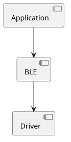
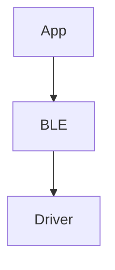

# UML vs SysML for Firmware and System Engineering

## Executive Summary

| Usage | Recommended |
|---------|---------|
| Firmware architecture | UML |
| Embedded software design | UML |
| RTOS task decomposition | UML |
| Driver/HAL architecture | UML |
| Hardware/Software/System architecture | SysML |
| Requirements traceability | SysML |
| Product line engineering | SysML |
| Safety-critical systems | SysML + UML |
| New MBSE projects | SysML v2 |

### Rule of Thumb

```text
Inside the firmware -> UML

Across the product -> SysML

Future-facing MBSE -> SysML v2
```

---

# UML

UML was designed primarily for software systems.

Most useful diagrams for embedded development:

## Component Diagram

```text
Application
   |
Services
   |
HAL
   |
Drivers
```

Use for:

- Layered firmware architecture
- Middleware organization
- Driver dependencies

## State Machine Diagram

```text
Reset
  |
Init
  |
Idle <--> Active
  |
Sleep
```

Use for:

- Protocol stacks
- Bootloaders
- Power management
- BLE and USB state handling

## Sequence Diagram

```text
Application
   |
BLE Stack
   |
Radio Driver
```

Use for:

- Firmware update flows
- Communication protocols
- Interaction analysis

## Deployment Diagram

```text
MCU1 <--> MCU2
```

Use for:

- Multi-core systems
- Distributed embedded systems

---

# SysML v1

SysML extends UML for systems engineering.

Key additions:

- Requirements
- HW/SW co-design
- Verification
- Mechanical and electronics integration

## Useful Diagrams

### Requirement Diagram

```text
REQ-001
Boot time < 500 ms
```

### BDD (Block Definition Diagram)

```text
Sensor Node
 ├─ MCU
 ├─ Battery
 ├─ Sensor
 └─ BLE Radio
```

### IBD (Internal Block Diagram)

```text
MCU --SPI--> Flash
MCU --I2C--> Sensor
```

### Parametric Diagram

```text
Battery life = Capacity / Average Current
```

## Criticism of SysML v1

Common complaints:

- Heavy tooling
- Large models
- Steep learning curve
- Poor Git integration
- Repository-centric workflow

---

# SysML v2

Major redesign focused on:

- Textual modeling
- APIs
- Automation
- Interoperability
- Software-engineering-friendly workflows

Example:

```sysml
part def MCU;
part def Flash;

part Board {
    part cpu : MCU;
    part extFlash : Flash;
}
```

Benefits:

- Git-friendly
- Easier reviews
- Better CI/CD integration
- Reduced vendor lock-in

---

# Recommended Tooling

## UML

### PlantUML (Recommended)

Pros:

- Text-based
- Git-friendly
- Excellent VS Code support
- State, sequence and component diagrams

Example (GitHub Pages does not render PlantUML, so the diagram below is a pre-rendered SVG of the source):



```text
@startuml
component Application
component BLE
component Driver

Application --> BLE
BLE --> Driver
@enduml
```

### Mermaid

Good for:

- Markdown documentation
- GitHub / Azure DevOps integration

Example:



### StarUML

Good graphical UML editor.

---

# SysML v2 Tools

## SysON

Open-source SysML v2 platform.

Advantages:

- Open source
- Web-based
- Graphical and textual editing
- Active Eclipse ecosystem

Recommended for learning SysML v2.

## Cameo / CATIA Magic SysML v2

Industrial-grade solution.

Advantages:

- Mature ecosystem
- Requirements traceability
- Aerospace/defense adoption

Disadvantages:

- Expensive
- Heavy for firmware-only projects

## OMG SysML v2 Pilot Implementation

Reference implementation.

Best suited for:

- Learning language syntax
- Experimentation

---

# VS Code Recommendations

## PlantUML Extension

Publisher: jebbs

Features:

- Live preview
- SVG export
- PNG export
- Integrated workflow

## Mermaid

Often requires no extension because GitHub and Azure DevOps render it directly.

---

# Opinion on Tessera

The strongest aspect of Tessera is the philosophy:

```text
One Model
   |
   +-- Text
   |
   +-- Diagrams
```

This aligns closely with:

- Git
- Code review
- CI/CD
- Software engineering workflows

Compared with traditional SysML v1:

```text
Repository
   |
   +-- Drag and drop diagrams
```

The SysML v2 direction is increasingly:

```text
Model as Code
```

rather than:

```text
Diagram as Artifact
```

Evaluation checklist for Tessera:

1. SysML v2 compliance
2. Model exchange capability
3. Git friendliness
4. Diagram generation from model
5. Requirements traceability

---

# Recommended Learning Path

## Step 1

Learn:

- Component diagrams
- Sequence diagrams
- State diagrams

Using:

- PlantUML
- VS Code

## Step 2

Learn SysML Concepts:

- Requirements
- BDD
- IBD
- Allocation

## Step 3

Move to SysML v2:

- Tessera
- SysON

## Step 4

Evaluate industrial platforms:

- Cameo / CATIA Magic
- SysON
- Tessera

---

# Final Recommendation

For a Firmware R&D Engineer:

```text
Firmware Architecture
    -> PlantUML + VS Code + Git

System Architecture
    -> SysML v2
       (Tessera or SysON)
```

The future trend is clearly toward:

```text
Textual models
+ Git
+ Generated diagrams
+ Standard APIs
```

rather than large repository-centric modeling environments.

[Back to Software Architecture & Modeling](./)
